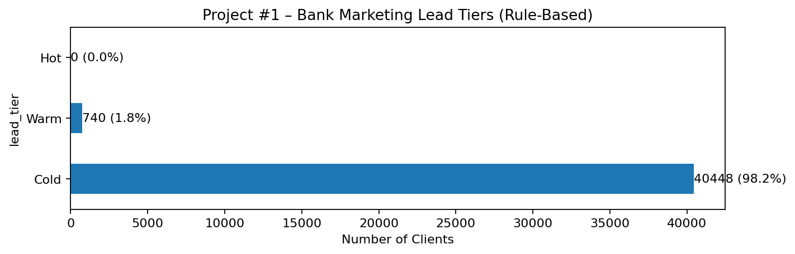

# Bank Marketing — Rule-Based Scoring

Rule-based scoring of bank marketing campaign records, using explicitly defined weights and tiers.

## Project contents

- [Analysis notebook](notebooks/05_Bank_RuleBased_Scoring.ipynb)
- [Figures](images/)

## Approach

A weighted, transparent rule-based system assigns scores and categories using historical campaign attributes. The weights are analyst-defined rather than learned probabilities.

## Figures

## Data and reproducibility

- The notebook input is linked from this [Kaggle Bank Marketing notebook](https://www.kaggle.com/code/gatewj/bank-marketing-dataset/input); the originating dataset listing and redistribution license remain unverified. No row-level records are redistributed. The predictive Bank Marketing project uses the same dataset.

- Notebook cell outputs have been cleared in this public copy. Run locally after obtaining the appropriate dataset and reviewing its terms.

- The analysis is retrospective; no live CRM integration, prospective testing, or measured business improvement is demonstrated.

- The scoring rules are heuristics, not calibrated conversion probabilities. On the supplied 41,188-row dataset they assign **40,448 Cold**, **740 Warm**, and **0 Hot** records. This imbalance is a limitation of the current rules, not a validated prioritization result.

- Call duration is known only after an interaction, so duration-based scoring cannot be used unchanged for pre-call prioritization.

The notebooks may require local file-path adjustments and installation of the libraries imported in their code.

**Input:** `Bank_Marketing.csv` (semicolon-delimited), expected in the notebook working directory. **Local output:** no row-level export is performed by the public notebook.
