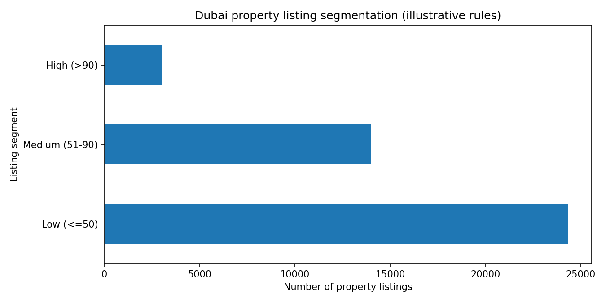

# Dubai Property Listings — Rule-Based Segmentation

Rule-based segmentation of property listings by their recorded attributes; not a buyer conversion model.

## Project contents

- [Analysis notebook](notebooks/05_Dubai_Real__Estate_Rule_Based.ipynb)
- [Figures](images/)

## Approach

A transparent rule-based approach segments listings using property attributes. It is an inventory segmentation exercise, not a model of buyer intent.

## Figures

**Validated on the supplied Bayut CSV (41,381 listings):** Low (<=50): 24,338, Medium (51-90): 14,003, High (>90): 3,040. These are counts from illustrative rules, not observed conversion rates.

## Data and reproducibility

- The notebook input `bayut_selling_properties.csv` is linked from this [Kaggle notebook](https://www.kaggle.com/code/azharsaleem/unlocking-real-estate-gold-in-depth-analysis/input?select=bayut_selling_properties.csv); the originating dataset listing and redistribution license remain unverified. No row-level records are redistributed.

- Notebook cell outputs have been cleared in this public copy. Run locally after obtaining the appropriate dataset and reviewing its terms.

- The analysis is retrospective; no live CRM integration, prospective testing, or measured business improvement is demonstrated.

- The records represent property listings rather than confirmed prospective buyers. Scores and tiers describe listing attributes, not conversion likelihood.

The notebooks may require local file-path adjustments and installation of the libraries imported in their code.

**Input:** `bayut_selling_properties.csv`, expected in the notebook working directory. **Local output:** no row-level file is written by the public notebook. The location, price, Arabic-script and other weights are subjective examples, not validated market predictors.
