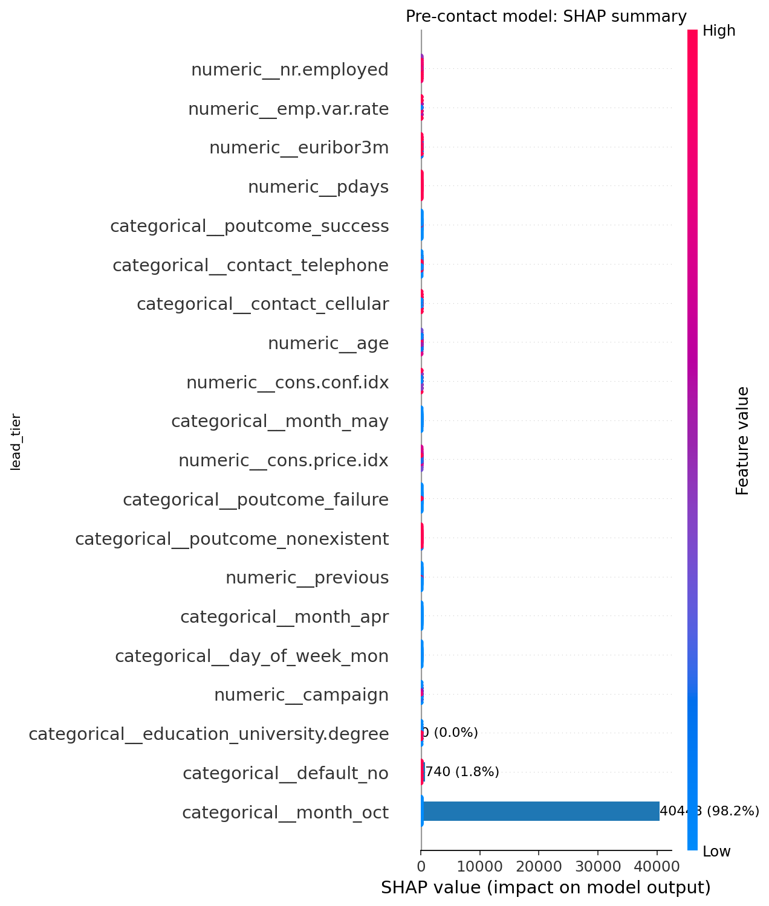
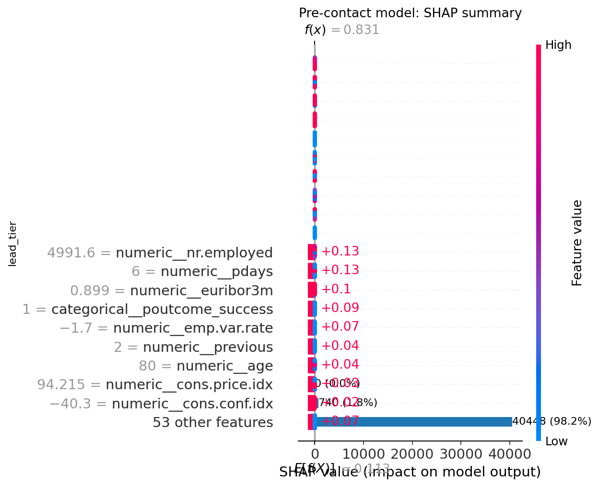

# Bank Marketing — Predictive Modeling and SHAP

Random Forest classification of term-deposit subscription outcomes, with SHAP interpretation.

## Project contents

- [Analysis notebook](notebooks/04_Predictive_Scoring_Code.ipynb)
- [Figures](images/)

## Approach

A Random Forest model classifies historical bank campaign subscription outcomes. SHAP plots are included to illustrate feature contributions to model predictions.

## Figures

## Data and reproducibility

- The notebook input is linked from this [Kaggle Bank Marketing notebook](https://www.kaggle.com/code/gatewj/bank-marketing-dataset/input); the originating dataset listing and redistribution license remain unverified. No row-level records are redistributed. The rule-based Bank Marketing project uses the same dataset.

- Notebook cell outputs have been cleared in this public copy. Run locally after obtaining the appropriate dataset and reviewing its terms.

- The analysis is retrospective; no live CRM integration, prospective testing, or measured business improvement is demonstrated.

- **Verified revised holdout model:** ROC-AUC **0.8148**, average precision **0.4897**, using a 75/25 stratified random split of 41,188 records. One-hot encoding is fitted on training data only and call `duration` is excluded.

- At the default classification threshold, subscription recall is approximately **24%**; accuracy alone would be misleading because subscriptions are relatively rare.

- This is a historical random-split evaluation, not prospective performance validation. Scores are not calibrated or validated for CRM deployment.

- The regenerated SHAP figures explain the revised model, not causal effects or regulatory compliance.

**Input:** `Bank_Marketing.csv` (semicolon-delimited), in the notebook working directory. No row-level export is performed by the public notebook. Thresholds are illustrative, not business-optimized.
